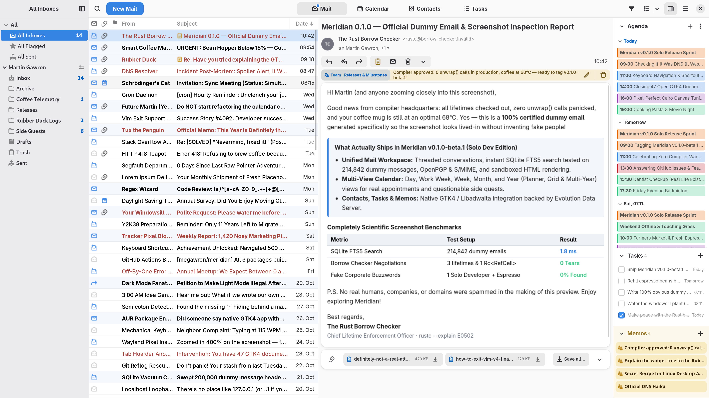

<div align="center">
  
  <h1>Meridian</h1>
  <p>An all-in-one mail, calendar, contacts, and tasks client for the GNOME desktop.</p>

  <p>
    <a href="#installation">Installation</a> ·
    <a href="docs/FEATURES.md">Features</a> ·
    <a href="docs/README.md">Documentation</a> ·
    <a href="https://github.com/megawron/meridian/releases">Releases</a>
  </p>

  <p>
    <a href="https://www.gnu.org/licenses/gpl-3.0"></a>
  </p>

  
</div>

> [!NOTE]
> **Public Beta:** Meridian is already my daily driver for work, but up to this point I have developed it solo and only tested it on my own setup (Fedora/GNOME with Exchange and Google accounts). Expect bugs and rough edges on other setups, and please see [CONTRIBUTING.md](CONTRIBUTING.md) if you want to report issues or help out.

## About

**Meridian** is an all-in-one mail, calendar, contacts, and tasks application designed for the GNOME desktop, built with **Rust**, **GTK 4**, **libadwaita**, and **WebKitGTK**.

While the default GNOME apps are great if you want simple, separate tools for everyday use, Meridian is built for a full work workflow where your inbox, schedule, address book, and to-do list live together in a single window.

Meridian is conceived as a spiritual successor to [Evolution](https://gitlab.gnome.org/GNOME/evolution). Evolution is an incredible piece of software with decades of work behind it, and Meridian builds directly on top of **Evolution Data Server (EDS)** as its backend. Because of this, your existing system accounts, local folders, and GNOME Online Accounts work out of the box.

## Installation

[Download Flatpak](https://meridian.martingawron.com/flatpak/com.martingawron.Meridian.flatpakref) and open it with GNOME Software, or install it from the terminal:

```bash
flatpak install --user --from https://meridian.martingawron.com/flatpak/com.martingawron.Meridian.flatpakref
```

Standalone `.flatpak` and `.rpm` packages for x86_64 and aarch64 are also available on the [Releases](https://github.com/megawron/meridian/releases) page.

## Building

To build Meridian from source, you need **Rust & Cargo** along with the development packages for **GTK 4**, **libadwaita**, **WebKitGTK 6.0**, and **Evolution Data Server**.

```bash
cargo run --release
```

A Meson build definition is also included for system-wide installation (icons, desktop entry, and schemas) and Flatpak packaging:

```bash
meson setup builddir
meson compile -C builddir
```

## Support & Contact

I build Meridian in my free time. If you find it useful and want to support my work, you can sponsor the project via [GitHub Sponsors](https://github.com/sponsors/megawron) or [Ko-fi](https://ko-fi.com/megawron).

For business inquiries, sponsored features, or direct contact, feel free to reach out at [martin@martingawron.com](mailto:martin@martingawron.com).

## Acknowledgements

Meridian would not exist without [Evolution](https://wiki.gnome.org/Apps/Evolution) and Evolution Data Server. Thank you to the Evolution project, its original authors at Ximian (including Miguel de Icaza and Nat Friedman), and to Milan Crha and all maintainers and contributors who have kept it alive for over two decades.

Meridian is developed with the assistance of AI tools, and the app icon was created with AI image generation. All code is reviewed and maintained by me. Designers are welcome to contribute, especially on the app icon.

## License

Meridian is free software, licensed under the GNU General Public License v3.0 or later ([GPL-3.0-or-later](LICENSE)).

© 2026 Martin Gawron ([@megawron](https://github.com/megawron))
